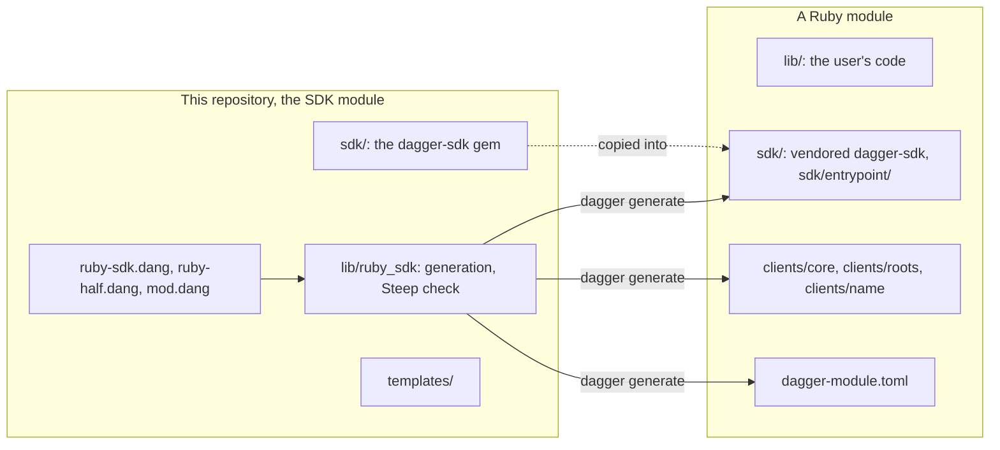
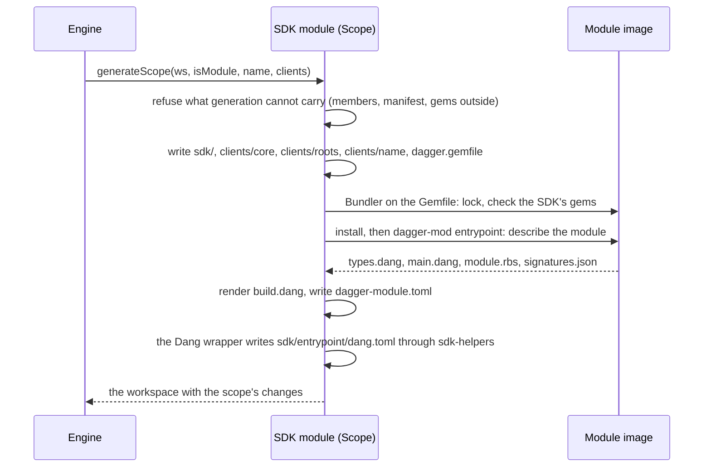

# The Ruby SDK: design notes

How the SDK is built and why. The README says how to use it, and `AGENTS.md`
how to work on it.

## What it is

A workspace SDK. The engine records each Ruby scope in `dagger.toml` and asks
the SDK module, the root of this repository, to generate it. A scope is a
directory with a `Gemfile`: a module, or a plain project that only uses
clients. Code generation happens at `dagger generate` and nowhere else; a
module then runs from its committed generated files, on a Dang entrypoint
generated into it (manifest v2), and on its current source, so an edited
function body runs without generating again.



## The SDK module

The SDK module is a Dang module, `[runtime] source = "dang"`, as the Python
and Java SDK modules are. A Ruby SDK module would need a generated entrypoint
of its own, so the SDK would generate itself before it could run; the Dang
wrapper needs none, and runs the Ruby half in a plain exec. `ruby-sdk.dang`
declares the API:
`findClientRoot`, `generateScope`, the `steep` check and `mod(path:).steep`.
Each runs the Ruby half, `lib/ruby_sdk.rb`, in an exec on the pinned Ruby
image (`images/ruby/Dockerfile`), with the request on stdin, objects by ID and
the result in a file (`ruby-half.dang`). The SDK module reads its own files
from `currentModule.source`, never from the caller's workspace, which holds
the SDK only when the SDK sits in it.

## Generation



- `RubySdk.targetVersion` in `ruby-sdk.dang` is the Dagger version of what
  generation writes. The request carries it to `Scope`, which selects the
  clients' schema view with it. The Ruby half's own process keeps the
  manifest's `engineVersion`.
- The Dang wrapper writes `sdk/entrypoint/dang.toml` with `sdk-helpers`, from the
  file in the workspace it received, because the Ruby half replaces `sdk/` whole.
  A plain scope gets no file and keeps one it has. `RubySdk::DangConfig`
  refuses what the helper would drop or what contradicts the target, and
  `Scope.check_dang_config` is one of generation's refusals the Steep check runs.
- Every generated member carries a `.dagger-generated` marker naming its kind.
  A directory where a member goes without the marker is the user's: generation
  refuses to write over it and never deletes it. The user's `Gemfile` gets one
  line, `eval_gemfile "dagger.gemfile"`.
- The members are path gems: `dagger-sdk` (`sdk/`), `dagger-clients-core`,
  `dagger-clients-roots`, and one `dagger-clients-<name>` per client. Nothing
  is published to RubyGems; a scope vendors what it runs.
- Bundler runs in the image the module builds on, so the lock is the one its
  build uses. A Bundler other than the lock's restarts and drops
  `-rbundler/setup`, so generation writes the image's own Bundler version.
- `dagger-mod entrypoint` loads the module's files in its installed container,
  without a session, and describes it with the types its annotations give.
  The registry refuses what the API cannot carry, naming the file and line.

## Declaring types: RBS annotations

A module's types are RBS in `#:` comments: at the end of a field's line, and
above a `def`. The SDK module parses them at generation with `rbs` 4's inline
parser and Prism (`lib/ruby_sdk/signatures.rb`), and writes what it read to
`sdk/entrypoint/signatures.json`; the module's runtime reads that file and
never needs `rbs`. Annotations are also what Steep checks the code against, so
one notation serves the API and the type checker. What a type cannot say (a
description, an API name, check or generator flags, engine options) is
declared in the DSL right before the `def`.

Generation writes the module's own `sdk/entrypoint/module.rbs`, the readers
and initializers that `field` defines and the members of each enum, which
Steep cannot infer.

## A call

```mermaid
sequenceDiagram
  participant E as Engine
  participant M as main.dang
  participant B as build.dang
  participant R as dagger-mod call
  E->>M: call(receiverType, receiverValue, fnName, fnArgs, callDigest)
  M->>B: RubyModuleBuild(source).installed
  B->>B: gems from the Gemfiles, by content; then the source
  M->>R: exec with the request on stdin
  R->>R: restore the receiver, convert the arguments, run the method
  R-->>M: /dagger/result.json
  M-->>E: the result as JSON
```

- The request carries `callDigest`, which keys the exec on the call's whole
  identity, its declared clients included (dagger/dagger#14491).
- It carries the module's own source by ID, which `Dagger::Mod.module_source`
  gives module code.
- The gems install from `Gemfile`, `Gemfile.lock`, `dagger.gemfile` and the
  members' gemspecs, by their contents, before the rest of the source: an edit
  to `lib/` reuses the installed gems.
- The install exec sets `disableDaggerInDagger`. The engine adds the module to
  the identity of a nested exec of an entrypoint since v1.0.0-beta.20, and that
  identity changes with the module's source.
- Bundler's cache sits in one shared cache volume, in a directory per
  module and one for its development install: Bundler names its temporary
  files by process ID, which repeats across containers, so two builds that
  write one directory at once fail.
- A failed install prints Bundler's error, then the hint to run
  `dagger generate`: nothing records whether a module was generated since its
  last edit, so the hint follows the errors that a missed generation causes.

## The entrypoint contract

The engine loads a module through the type of `main.dang` that implements
`ModuleEntrypoint`, and picks the contract by whether it declares `sources`:

| Member | Without `sources` | With `sources` |
| --- | --- | --- |
| `sources(workspace: Workspace!): Directory!` | absent | the files outside the module, at their paths from the workspace's root |
| `types` | `types(workspace: Workspace!): [TypeDef!]!` | `types: [TypeDef!]!` |
| `call` | `call(workspace: Workspace!, receiverType, receiverValue, fnName, fnArgs, callDigest)` | the same, without `workspace` |

`types` returns `ModuleTypes().all`, the literal typedefs of `types.dang`.
`callDigest` is a nullable argument that the engine passes to an entrypoint
that declares it. Neither contract reads the workspace: the module's files
come from `currentModule`. Only a module with gems outside its directory
declares `sources`, so every other module keeps the same files and has no
member for the engine to evaluate at every load.

## Gems outside a module

A module's Gemfile can name a gem outside the module's directory, in the same
repository: `gem "shared", path: "../shared"`. The engine loads a module's own
directory only. `RubySdk::Resources` (`lib/ruby_sdk/resources.rb`) parses the
Gemfile with Prism and follows every `eval_gemfile`, reading string literals
only:

| Form | What it adds |
| --- | --- |
| `gem "x", path: "../x"` | the directory `../x` |
| `path "../gems" do ... end` | the directory `../gems` |
| `gemspec path: "../tool"` | the directory `../tool` |
| `eval_gemfile "../Gemfile.common"` | the file, which it then reads in turn |
| `ruby file: "../.ruby-version"` | the file |

A path is relative to the file that names it, as Bundler resolves it, and kept
only when it leaves the module's directory; a directory nested in another one
goes. `sources` returns the manifest, which the engine requires at the module's
path, then each directory without its `.bundle` and `vendor/bundle`, then each
file, at the module's path joined to its path from the module:

```dang
pub sources(workspace: Workspace!): Directory! {
  let cwd = workspace.cwd
  directory
    .withFile(cwd + "/dagger-module.toml", workspace.file("dagger-module.toml"))
    .withDirectory(cwd + "/../shared", workspace.directory("../shared", exclude: [".bundle", "vendor/bundle"], gitignore: true))
}
```

The engine evaluates `sources` at every load of the module, adds what it
returns to the module's context directory and digest, and keys every call on
it: an edit to the gem gives a new result, a file outside that `sources` does
not return does not. The paths stay relative to the module, so the member does
not depend on where the module sits; `gitignore: true` keeps the rules that the
engine applies to a local module's own files. Excluding `vendor/bundle` keeps
an empty `vendor/`, whose appearance alone gives a new result.

`build.dang` then takes `currentModule.contextDirectory`, the module's source
overlaid at `currentModule.sourceSubpath`, and works from `/src/<subpath>`. The
install layer holds the Gemfiles, the lock, `dagger.gemfile`, the members'
gemspecs and every file of the gems outside, each by its contents, so an edit
to `lib/` reuses the installed gems and an edit to a gem outside installs them
again; a directory of the context would carry the module's source in the cache
key.

Generation refuses, naming the scope, the file and the line, and the Steep
check refuses the same:

| Refused | Why |
| --- | --- |
| A path that is not a string literal | generation cannot read it |
| An absolute path, or one starting with `~` | it names a file outside the repository |
| A path that leaves the workspace's root, or only climbs (`..`) | the workspace ends there; `..` holds the module itself |
| A path that names nothing, or whose files `.gitignore` all ignores | Bundler would fail; a local module's context drops them |
| A path gem in the lock that the Gemfile does not name as a literal | the build would miss it |
| An engine without `CurrentModule.contextDirectory` and `sourceSubpath` | the build reads the context through them |

Only what the Gemfile names is loaded: a file the module's code reads outside
its directory, with `require_relative` or `File.read`, is not there. A plain
scope needs no `sources`: it runs on its host, where Bundler reads the gems
outside directly.

## Clients

A client is a Ruby library generated from the schema of a module or of the
core API: one class per type, a lazy `QueryBuilder` per object, and a
synchronous call per leaf. `clients/roots` gives a class that includes
`Dagger::Clients::Roots` one private method per client, `core` included. Each
client records the core it was generated against (`CORE_DIGEST`); loading one
generated against another core fails with a stale-client error.

An object fetches its ID once and remembers it, unless the schema marks a
field it was built through `@reevaluate`, or `@reevaluate(when:)` and the call
set one of those arguments: such an object, and every object chained on it,
fetches its ID on every use, as the Go client does.

## Collections

A class with `collection` becomes an engine collection: the engine gives it
`keys`, `get`, `list`, `subset` and `batch`, runs a check of its item type
once per item, and computes the delta of a selection. Members go by the
engine's names (`keys`, `get`, `delta`) or are marked (`keys:`, `get:`,
`delta:`). `Dagger::Mod::CollectionRules` checks the engine's rules at
generation, at the member that breaks one. The engine sends a collection's
base as opaque state, `__daggerCollectionBase`; the runtime keeps it in a
hidden instance variable, so a copy of the receiver carries it back.

## The Steep check

`ruby-sdk:steep` finds every Ruby module the SDK generated in the workspace,
by what generation writes into it, and runs generation's own refusals on each
(the same class methods of `RubySdk::Scope`), then Steep against the
`module.rbs` that generation would write, in the module's image with its
Gemfile's development group. A passing check means `dagger generate` accepts
the module. `dagger call ruby-sdk mod --path <module> steep` checks one.

## The engine

The SDK requires Dagger v1.0.0-beta.19 or later, and checks no engine
version: it runs on whatever engine it is given. A feature is checked by its
schema where generation can see it: a module with gems outside its directory
builds from `CurrentModule.contextDirectory` and `sourceSubpath`. Whether the
engine evaluates the entrypoint's `sources`, which loads those gems, no schema
field shows, so nothing checks it. The checks run in Dagger Cloud, on its
engine, and a nested `dagger` in them is that engine's own CLI. The README
lists the known engine limitations.

## Decisions

| Decision | Why | Not chosen |
| --- | --- | --- |
| Generation at `dagger generate` only, committed | a module runs without the SDK module, and a call runs no codegen | generating at call time |
| Manifest v2 with a Dang entrypoint | the engine's direction; the entrypoint is plain Dang the SDK renders | the runtime SDK protocol |
| Types in RBS annotations | one notation for the API and for Steep | a Ruby DSL for types, which Steep cannot read |
| Vendored path gems | a module carries what it runs; nothing to publish before the API settles | RubyGems releases |
| No engine version gate | a custom engine must run the SDK; features are checked by schema | a version floor |
| The SDK module in Dang | it needs no generated entrypoint, so the SDK never generates itself | a manifest-v2 Ruby SDK module |
| Gems outside a module from the Gemfile | Bundler already names them; the entrypoint's `sources` returns them | an `include` list in the manifest |
| No workspace restriction in the SDK | an installed module may read its caller's workspace; the SDK keeps a module's source and files its own, and the check covers that | a sandbox in the SDK, or a check that a module cannot read the workspace |
| `sources` only in a module with gems outside | a module without them keeps the same files, with no member to evaluate at every load | `sources` in every entrypoint, returning the manifest alone without gems outside |
